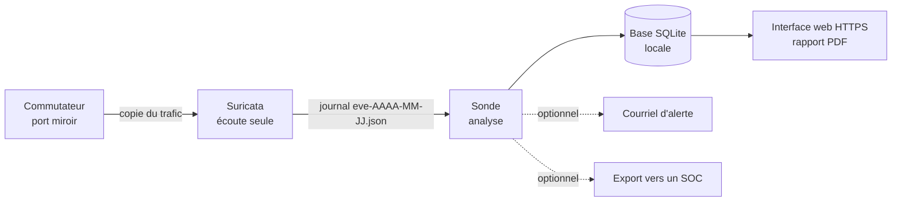
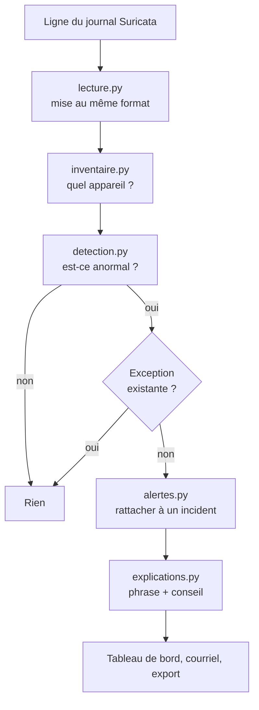
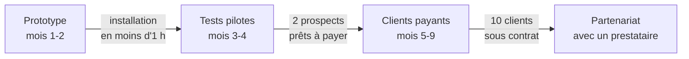

# Shadowreef — contexte et concept du projet

Ce document explique d'où vient le projet, à qui il s'adresse, ce que fait la sonde et pourquoi
elle est construite ainsi. Il est fait pour quelqu'un qui rejoint le projet.

**En une phrase :** Shadowreef est une sonde logicielle installée chez une petite entreprise, qui écoute son
réseau, repère ce qui est anormal et l'explique en français clair à un dirigeant qui n'est pas
informaticien.

**D'où vient le nom :** *shadow* (l'ombre) pour ce qui se cache dans le réseau, dont les appareils
installés sans que l'entreprise le sache ; *reef* (le récif) pour ce qui est sous la surface, et
pour La Réunion. Dans les phrases, on continue de dire « la sonde ».

## Sommaire

1. [D'où vient l'idée](#1-doù-vient-lidée)
2. [Le marché visé](#2-le-marché-visé)
3. [Le concept en cinq principes](#3-le-concept-en-cinq-principes)
4. [Ce que fait la version 1, et ce qu'elle ne fait pas](#4-ce-que-fait-la-version-1-et-ce-quelle-ne-fait-pas)
5. [Les utilisateurs](#5-les-utilisateurs)
6. [Comment ça marche](#6-comment-ça-marche)
7. [Les choix techniques et leurs raisons](#7-les-choix-techniques-et-leurs-raisons)
8. [Le test pilote chez un prospect](#8-le-test-pilote-chez-un-prospect)
9. [Feuille de route](#9-feuille-de-route)
10. [Par où commencer quand on rejoint le projet](#10-par-où-commencer-quand-on-rejoint-le-projet)
11. [Questions ouvertes](#11-questions-ouvertes)
12. [Glossaire](#12-glossaire)
13. [Sources](#13-sources)

---

## 1. D'où vient l'idée

Le point de départ est **Darktrace**, un éditeur britannique de cybersécurité (environ 2 300
employés, près de 10 000 clients, racheté 5,3 milliards de dollars par le fonds Thoma Bravo en 2024).

Son principe : au lieu de chercher uniquement des attaques déjà connues, le produit apprend le
comportement normal de chaque appareil d'une organisation, puis signale les écarts. Trois briques :

| Brique chez Darktrace | Rôle | Équivalent dans Shadowreef |
| --- | --- | --- |
| Détection | Repérer les anomalies sur le réseau | Détecteurs + période d'apprentissage |
| Cyber AI Analyst | Relier les alertes et rédiger un rapport lisible | Regroupement en incidents + phrases en français |
| Réponse autonome | Bloquer automatiquement une attaque | **Absent** : la sonde observe, elle ne bloque rien |

**Nous ne copions pas Darktrace.** Son moteur d'intelligence artificielle représente plus de dix
ans de travail de centaines d'ingénieurs, et son prix le réserve aux grandes structures. Nous
reprenons l'idée (apprendre l'habitude, signaler l'écart, expliquer simplement) avec des moyens
adaptés à deux développeurs et à des clients de 10 à 100 postes.

Les avis d'utilisateurs de Darktrace pointent deux faiblesses qui sont notre terrain : un prix
élevé et une longue période de réglage pour réduire les fausses alertes.

## 2. Le marché visé

**Cible : les TPE et petites PME de La Réunion, de 10 à 100 postes, sans équipe de sécurité.**
Cabinets comptables, cabinets médicaux, PME du bâtiment et du commerce, associations, petites
mairies.

| Constat | Chiffre | Remarque |
| --- | --- | --- |
| Entreprises à La Réunion | Environ 65 000 | Très majoritairement sans salarié ou de moins de dix salariés |
| PME (hors micro-entreprises) | Environ 1 500 | Donnée Insee ancienne (2013), ordre de grandeur |
| Incidents déclarés à l'ANSSI | 14 en 2023, 11 en 2022 | Chiffres reconnus comme très inférieurs à la réalité |
| Entités visées en France par la directive NIS2 | Environ 15 000, dans 18 secteurs | Transposition (« loi Résilience ») en cours d'adoption fin 2026 |

Pourquoi maintenant :

- **La réglementation pousse.** La directive européenne NIS2 obligera les entités concernées, et
  par ricochet leurs fournisseurs, à prouver qu'elles détectent et traitent les incidents.
- **La sensibilisation est déjà financée par le public.** Cyber Réunion (centre de réponse aux
  incidents porté par la Région), la CCI et le réseau MonAideCyber font ce travail.
- **L'offre existante vise plus gros.** Les centres de supervision (SOC) locaux et hexagonaux
  s'adressent à des structures qui peuvent payer une surveillance humaine permanente. Un repère
  de prix trouvé pour l'Hexagone : environ 1 500 € par mois pour une petite structure.

Le paysage local, pour situer le projet :

| Acteur | Rôle |
| --- | --- |
| Cyber Réunion (CSIRT + EDIH) | Assistance publique et gratuite en cas d'incident pour TPE, PME, collectivités |
| Prestataires locaux avec SOC (par exemple Exodata) | Supervision, audit, réponse aux incidents pour des structures plus grandes |
| SOC de l'Hexagone (par exemple ITrust) | Supervision mutualisée, présents sur le secteur public |
| Grands éditeurs (Darktrace, Vectra...) | Vendus par des intégrateurs, trop chers pour la plupart des PME locales |

**Notre place :** l'étage du dessous. Un outil assez simple et assez peu cher pour une structure
de 15 personnes, et assez standard pour qu'un prestataire puisse un jour le brancher sur son
centre de supervision et suivre des dizaines de petits clients.

## 3. Le concept en cinq principes

1. **Tout reste chez le client.** La sonde tourne sur une machine du client. Les données ne
   sortent pas de ses locaux. C'est un argument de confiance, et cela nous évite tout coût
   d'hébergement.
2. **Écoute seule.** La sonde reçoit une copie du trafic. Elle ne bloque rien, ne modifie rien,
   n'émet rien sur le réseau surveillé. Elle ne peut donc pas provoquer de panne.
3. **Du français clair, pas du jargon.** Chaque incident tient en une phrase compréhensible et
   une action à faire. Le dirigeant doit savoir en une minute si tout va bien.
4. **Peu d'alertes, mais utiles.** Une semaine d'apprentissage, le regroupement des signaux, et
   le bouton « C'est normal » servent tous à éviter de noyer le client.
5. **Zéro achat pour démarrer.** Logiciels libres, matériel déjà existant, installation par un
   seul script.

## 4. Ce que fait la version 1, et ce qu'elle ne fait pas

| Dans la version 1 | Hors version 1 |
| --- | --- |
| Écoute passive du trafic par un port miroir | Blocage automatique d'une attaque |
| Détection d'attaques connues (règles libres) | IA auto-apprenante (demande des mois de données réelles) |
| Détection d'anomalies simples | Protection des postes, de la messagerie, du cloud |
| Inventaire des appareils | Surveillance humaine 24 h/24 |
| Incidents expliqués en français | Déchiffrement du trafic chiffré |
| Rapport PDF | Console centrale pour suivre plusieurs clients (version 2) |
| Interface web locale | Solution pour les clients sans port miroir |
| Courriel d'alerte, export vers un SOC | |

Limite à dire clairement à un client : la sonde voit **qui parle à qui, quand et combien**, pas
le contenu des échanges chiffrés. C'est suffisant pour détecter beaucoup de choses, mais ce n'est
pas un antivirus et cela ne remplace pas les sauvegardes.

L'état précis de chaque besoin (couvert, partiel, à faire) est dans
[SUIVI_DES_BESOINS.md](SUIVI_DES_BESOINS.md).

## 5. Les utilisateurs

| Profil | Ce qu'il attend | Ce que la sonde lui donne |
| --- | --- | --- |
| Dirigeant du client, non technicien | Savoir en une minute si tout va bien, et quoi faire sinon | Tableau de bord vert, orange ou rouge ; une phrase et un conseil par incident ; rapport PDF |
| Nous (installation et suivi) | Installer vite, peu de fausses alertes, diagnostiquer | Script d'installation, commande `shadowreef etat`, exceptions, journaux |
| Analyste d'un SOC partenaire | Recevoir les alertes dans un format standard | Export JSON et syslog (RFC 5424) |

## 6. Comment ça marche

### Vue d'ensemble



Trois conteneurs Docker sur la machine du client : `suricata` (capture), `shadowreef` (analyse, une
lecture toutes les 30 secondes), `web` (interface). Rien d'autre.

### Le parcours d'un événement



### Ce que la sonde détecte

| Signal | Ce qui le déclenche | Gravité de départ | Besoin |
| --- | --- | --- | --- |
| Attaque connue | Une règle de Suricata reconnaît un trafic malveillant | Selon la règle : faible, moyenne ou élevée | F4 |
| Nouvel appareil | Un appareil jamais vu apparaît | Moyenne | F5 |
| Volume sortant | Un appareil envoie vers Internet plus de 500 Mo par jour, ou 3 fois son habitude | Moyenne | F6 |
| Balayage | Un appareil essaie 10 machines sur un même port, ou 30 ports sur une machine, en 5 minutes | Moyenne | F7 |
| Destination inhabituelle | Connexion directe à une adresse jamais vue, sans nom de site, sur un port inhabituel | Faible | F8 |
| Pays inhabituel | Premier échange avec un pays (si le fichier de pays est fourni) | Faible | F8 |
| Hors heures | Plus de 50 Mo envoyés la nuit ou le week-end par un appareil qui ne le fait pas d'habitude | Faible | F9 |
| Service exposé | Une machine interne accepte des connexions venues d'Internet | Point faible | F10 |
| Protocole en clair | Telnet, FTP, POP3, IMAP : mots de passe lisibles sur le réseau | Point faible | F10 |
| Sonde muette | Plus aucun trafic reçu depuis 30 minutes | Élevée | N9 |

Tous les seuils se règlent dans `/etc/shadowreef/shadowreef.toml`.

### Alerte, incident, point faible, exception

- Une **alerte** est un signal élémentaire.
- Un **incident** regroupe les alertes d'un même appareil survenues à moins de 2 heures
  d'intervalle. C'est ce que voit le dirigeant.
- Un **point faible** est un défaut durable (service exposé, protocole en clair). Il n'ouvre pas
  d'incident ; il figure dans un onglet à part et dans le rapport.
- Une **exception** est créée quand le client clique « C'est normal » : ce signal, pour cet
  appareil, ne reviendra plus. Elle peut être supprimée.

### La gravité

Trois niveaux : faible, moyenne, élevée. L'incident prend la gravité de son alerte la plus grave,
et **monte d'un cran quand deux signaux de nature différente touchent le même appareil** (par
exemple un nouvel appareil qui balaie le réseau). Seuls les incidents moyens et élevés changent
la couleur du tableau de bord ; les faibles sont affichés « à titre d'information ».

### L'apprentissage

Pendant les 168 premières heures, la sonde observe les habitudes : quels appareils existent,
combien chacun envoie, lesquels travaillent la nuit, quelles destinations sont courantes. Elle
signale déjà les attaques connues, les balayages et les points faibles, mais pas encore les
écarts d'habitude. C'est la « semaine de réglage » du test pilote.

### La sécurité de la sonde elle-même

Un outil qui voit tout le trafic d'un client est une cible. Ce qui est en place :

- interface servie uniquement en HTTPS, sans aucun JavaScript ni ressource externe ;
- mot de passe de 12 caractères au moins, hachage scrypt, verrouillage après 5 essais ratés ;
- jeton anti-falsification sur chaque action, cookies protégés, en-têtes de sécurité ;
- conteneurs sans privilège, en lecture seule, sous un compte dédié ;
- mises à jour acceptées seulement si elles sont signées par nous ;
- désinstallation qui supprime tout, avec un garde-fou contre la suppression d'un mauvais dossier.

## 7. Les choix techniques et leurs raisons

| Choix | Raison | Contrepartie |
| --- | --- | --- |
| **Suricata** pour la capture | Libre, éprouvé, un seul journal contient les alertes et l'activité (connexions, DNS, TLS, DHCP) | Consommation à mesurer sur un vrai trafic |
| Zeek seulement en option | Suricata suffit pour la version 1 ; un outil de moins à installer et maintenir | La lecture des journaux Zeek n'est testée que sur des échantillons |
| **Python** pour l'analyse | Rapide à écrire et à tester à deux ; performance largement suffisante (7 500 événements par seconde mesurés) | Pas adapté à de très gros réseaux |
| **SQLite** comme base | Un seul fichier local, aucune installation, rien à administrer | Une seule machine ; pas de partage entre sites |
| Interface **sans JavaScript** | Surface d'attaque minimale, aucune dépendance, fonctionne partout | Pas de rafraîchissement automatique des pages |
| **Docker** pour l'installation | Une seule commande, identique sur toutes les machines, désinstallation propre | Docker doit être présent chez le client |
| Règles libres Emerging Threats | Gratuites, mises à jour chaque jour | Bruit à mesurer ; non essayées en laboratoire |
| Seuils fixes plutôt qu'une IA | Explicables au client, testables, sans données d'entraînement | Moins fin qu'un vrai apprentissage statistique |
| Tests écrits avant le code | Chaque besoin a sa preuve ; un défaut corrigé ne revient pas | Plus long au départ |

La couche d'intelligence artificielle viendra plus tard, quand des tests pilotes auront fourni
des données réelles. La remplacer par des seuils simples en version 1 est un choix assumé.

## 8. Le test pilote chez un prospect

Le test dure 2 à 4 semaines et se termine par la remise du rapport en rendez-vous.

1. Entretien de prospection et accord de principe
2. Signature de l'autorisation d'écoute et de l'engagement de confidentialité
   ([modèles](MODELES_JURIDIQUES.md), à faire relire par un juriste)
3. Installation sur une machine du prospect (moins d'une heure)
4. Une semaine de réglage : nommer les appareils, marquer « normal » ce qui l'est
5. Une à trois semaines d'observation
6. Remise du rapport et proposition d'abonnement
7. Désinstallation et suppression des données si le prospect ne poursuit pas

Le projet continue si ces critères sont atteints (cibles à valider ensemble) :

| Critère | Cible |
| --- | --- |
| Prospects qui acceptent le test | Au moins 5 sur 30 contactés |
| Installation réussie en moins d'une heure | Sur chaque test |
| Rapport contenant au moins un constat utile au client | Sur chaque test |
| Prospects prêts à payer un abonnement après le test | Au moins 2 sur 5 |

**Écouter un réseau sans autorisation écrite est une infraction pénale, même pour un test
gratuit.** Aucune installation sans le document signé.

## 9. Feuille de route

Les durées sont des estimations à temps partiel.



| Phase | Contenu | Jalon pour passer à la suite |
| --- | --- | --- |
| Prototype | Sonde et interface, testées sur nos deux réseaux | Installation en moins d'une heure |
| Tests pilotes | 30 entretiens, 3 à 5 tests gratuits | 2 prospects prêts à payer |
| Clients payants | Société créée, assurance, 5 à 10 abonnés, console centrale | 10 clients sous contrat |
| Partenariat | Distribution en marque blanche par un prestataire déjà conforme | Accord signé |

On ne passe à la phase suivante que si le jalon est atteint. Sinon, on change de cible ou d'offre.

**Où nous en sommes :** la phase « Prototype » est faite en laboratoire (270 tests automatiques,
essai de bout en bout avec du trafic rejoué). Il manque l'essai sur un vrai réseau.

## 10. Par où commencer quand on rejoint le projet

**Première heure : comprendre.**

1. Lire ce document, puis le [README](../README.md).
2. Regarder l'aperçu du [tableau de bord](apercus/tableau-de-bord.png) et
   l'[exemple de rapport](apercus/exemple-rapport.pdf).
3. Lire [SUIVI_DES_BESOINS.md](SUIVI_DES_BESOINS.md) : ce qui marche, ce qui est partiel.

**Deuxième heure : faire tourner.**

```bash
git clone https://github.com/Etudiant8/sonde && cd sonde
```

```bash
python3 -m venv .venv && .venv/bin/pip install -e ".[dev]" pypdf
```

```bash
.venv/bin/python -m pytest
```

Puis installer la sonde sur son propre réseau en suivant le
[guide de test](GUIDE_TEST_RESEAU_PERSO.pdf) (3 pages).

**Ensuite : les chantiers ouverts, par ordre de priorité.**

| Chantier | Pourquoi c'est prioritaire | Où regarder |
| --- | --- | --- |
| Essai de deux semaines sur un vrai réseau avec port miroir | Rien n'a encore tourné sur du trafic réel | `docs/INSTALLATION.md` |
| Vérifier les règles Emerging Threats et mesurer leur bruit | Le nombre d'alertes par jour décide de la qualité perçue | `deploiement/suricata/demarrage.sh`, `shadowreef/detection.py` |
| Mesurer la mémoire et le processeur de Suricata | Fixe la configuration minimale à demander au client | `deploiement/docker-compose.yml` |
| Créer la paire de clés de signature | Sans elle, pas de mise à jour possible chez un client | `scripts/mettre_a_jour.sh` |
| Solution pour les clients sans port miroir (F2) | Cas fréquent en TPE | À concevoir |
| Fichiers « fabricant » et « pays » à fournir à l'installation | Deux besoins couverts en partie seulement | `shadowreef/inventaire.py`, `shadowreef/pays.py` |
| Console centrale multi-clients (version 2) | Nécessaire à partir de 3 ou 4 clients, et pour un partenaire | `shadowreef/export.py` comme point de départ |
| Faire relire les explications par une personne non technique | C'est le cœur de la promesse | `shadowreef/explications.py` |

**Règle de travail :** un test d'abord, qui échoue, puis le code qui le fait passer. Un défaut
trouvé en essai réel commence par un test qui le reproduit. Le détail est dans le README.

## 11. Questions ouvertes

- Qui prend la sonde (capture, détecteurs), qui prend l'analyse et l'interface, qui mène les
  entretiens de prospection ?
- Combien d'heures par semaine chacun peut-il y consacrer ?
- Quel nom pour le produit ?
- Quel prix d'abonnement tester ?
- Que fait-on quand le client n'a ni port miroir ni machine disponible ?
- À partir de combien de clients construit-on la console centrale ?
- Structure juridique, répartition des parts et pacte d'associés : quand et comment ?
- Chacun a-t-il vérifié son contrat de travail actuel (non-concurrence, propriété du code) ?

## 12. Glossaire

| Terme | Signification |
| --- | --- |
| Port miroir | Réglage d'un commutateur qui envoie une copie de tout le trafic vers une prise donnée |
| Commutateur | Boîtier sur lequel se branchent les appareils d'un réseau filaire (« switch ») |
| Sonde | Ici : le logiciel qui écoute le réseau et l'analyse |
| Suricata | Logiciel libre de détection d'intrusion qui lit le trafic et applique des règles |
| Règle, signature | Description d'un trafic malveillant connu ; Suricata alerte quand il la reconnaît |
| Emerging Threats | Jeu de règles libres, mis à jour chaque jour |
| NDR | Détection et réponse sur le réseau : la catégorie de produits de Darktrace |
| SOC | Centre de supervision : une équipe d'analystes qui surveille les alertes de plusieurs clients |
| Faux positif | Alerte qui signale une activité en réalité normale |
| Balayage | Recherche systématique de machines ou de ports ouverts, souvent avant une attaque |
| Adresse MAC | Identifiant matériel d'une carte réseau ; sert à reconnaître un appareil même s'il change d'adresse IP |
| DHCP | Service qui distribue les adresses IP ; il révèle le nom des appareils |
| NIS2 | Directive européenne qui impose des obligations de cybersécurité à de nombreux secteurs |
| ANSSI | Agence nationale de la sécurité des systèmes d'information |
| CSIRT | Équipe de réponse aux incidents ; Cyber Réunion en est une |
| syslog | Format standard d'envoi de messages vers un serveur de journaux |

## 13. Sources

Chiffres relevés en novembre 2026. Les données de Darktrace viennent en grande partie de ses
propres supports ; les chiffres de marché proviennent de millésimes différents et sont des ordres
de grandeur.

- [Darktrace — vue d'ensemble des produits](https://www.darktrace.com/fr/resources/darktrace-products-and-services-overview)
- [Fortune — rachat de Darktrace par Thoma Bravo](https://fortune.com/europe/2024/10/01/thoma-bravo-closes-5-3-billion-darktrace-acquisition-weeks-after-founding-investor-mike-lynchs-death/)
- [UpGuard — concurrents et avis sur Darktrace](https://www.upguard.com/competitors/darktrace)
- [Outremers360 — lancement de Cyber Réunion](https://outremers360.com/bassin-indien-appli/la-reunion-lancement-de-cyber-reunion-un-soutien-renforce-pour-la-cybersecurite-des-entreprises-et-des-organismes-publics)
- [Outremers360 — cyberattaques à La Réunion, incidents déclarés](https://outremers360.com/bassin-indien-appli/la-reunion-face-aux-cyber-attaques-letat-renforce-sa-mobilisation)
- [ANSSI — la directive NIS 2](https://cyber.gouv.fr/la-directive-nis-2)
- [Journal du Net — transposition de NIS2 à l'Assemblée](https://www.journaldunet.com/cybersecurite/1557881-nis2-l-assemblee-adopte-enfin-la-transposition-et-la-reecrit-contre-l-avis-du-gouvernement/)
- [Économie Matin — 65 390 entreprises à La Réunion](https://www.economiematin.fr/?p=239090)
- [Insee — entreprises à La Réunion](https://www.insee.fr/fr/statistiques/7721074)
- [Solutions Numériques — Exodata Cyberdefense](https://www.solutions-numeriques.com/fiche/exodata_cyberdefense)
- [ITrust — étude de cas CDG Réunion](https://www.itrust.fr/wp-content/uploads/2025/11/Etudedecas_Client_CDG_Reunion.pdf)
- [Opsio — prix d'un SOC managé](https://opsiocloud.com/fr/blogs/soc-managed-service-providers/)
